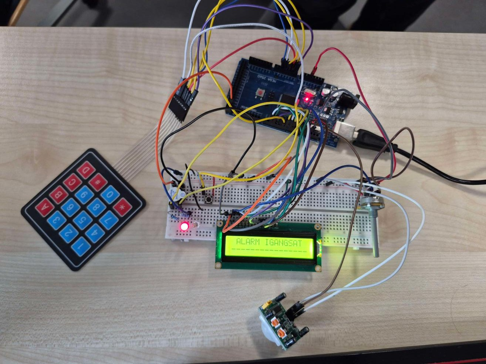
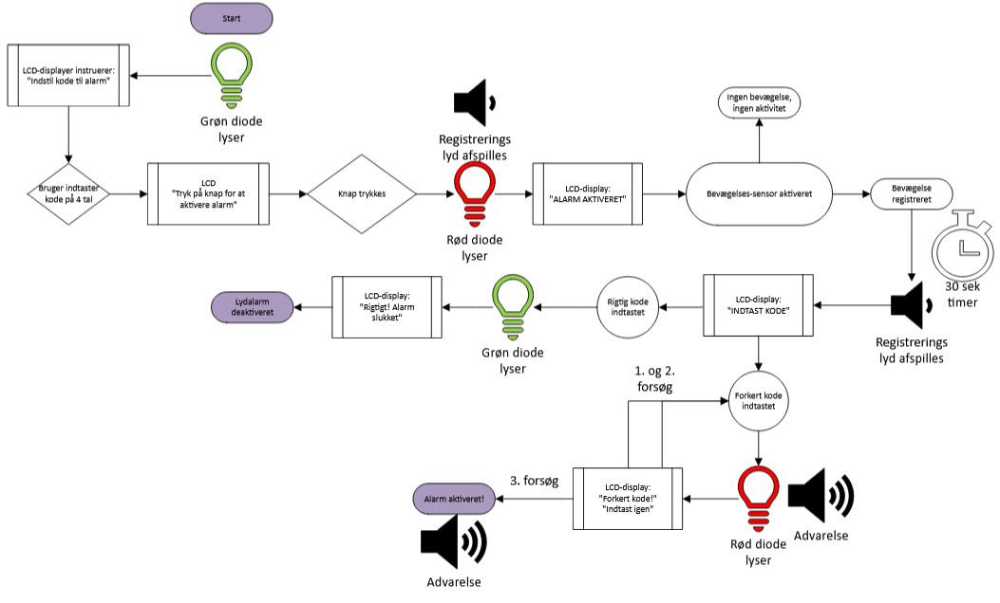
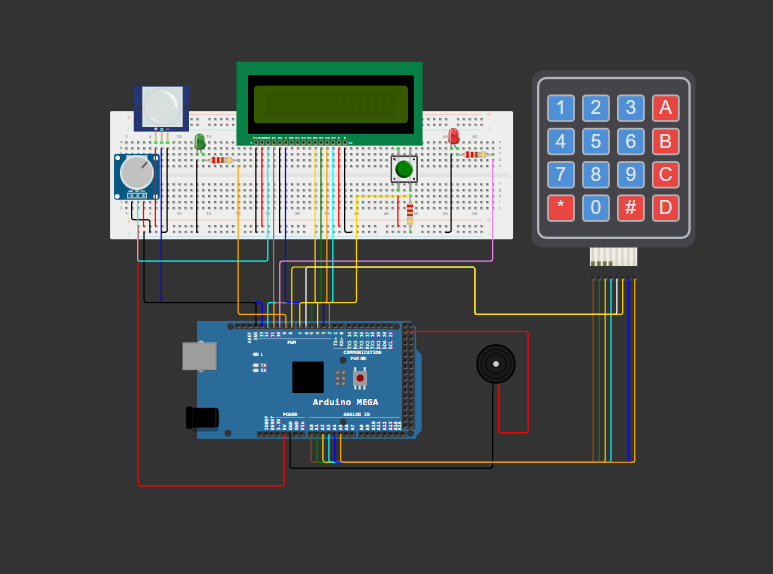

# Arduino Theft Alarm

A motion-triggered alarm that protects a valuable object. When someone moves near it, they have 30 seconds to enter a 4-digit code on a keypad. If they don't, or if they get the code wrong 3 times, the alarm goes off with a flashing red LED and a buzzer.

**Status:** Finished
**Context:** 1st semester project in Embedded Systems, IT-Technology at Zealand (EASJ), October 2025. One of our first projects. Group of 3.

> The report and the code comments are in Danish.

## Why

The project was inspired by the thefts from the Louvre. Our question was: *How can we protect valuable objects from theft using an Arduino and components?* The assignment required at least 3 inputs and 2 outputs. We ended up with 4 of each.

## How it works

1. On startup the green LED is on, and the LCD asks you to choose a 4-digit code.
2. Place the object in front of the motion sensor and press the button. The red LED lights up briefly, a beep sounds, and the alarm is armed.
3. When the PIR sensor detects movement, the LCD asks for the code and the buzzer starts beeping. You have **30 seconds**.
4. Correct code: the green LED turns on and the alarm is disarmed. Pressing `*` clears what you've typed without using up an attempt.
5. Wrong code 3 times, or time runs out: the alarm goes off with a flashing red LED and a loud tone.

The code uses `millis()` timers instead of `delay()` for most of the logic, so the alarm can watch the sensor, the keypad and the timer at the same time.

## Hardware

| Component | Type | Arduino pin |
| --- | --- | --- |
| Arduino Mega 2560 | Microcontroller | - |
| 16×2 LCD + 10 kΩ potentiometer (contrast) | Output / input | RS 2, E 3, D4–D7: 4, 5, 11, 12 |
| 4×4 membrane keypad | Input | Rows A0–A3, columns 6, 8, A4, A5 |
| PIR motion sensor | Input | 13 |
| Push button + 220 Ω resistor | Input | 7 |
| Green LED + 220 Ω resistor | Output | 9 |
| Red LED + 220 Ω resistor | Output | 10 |
| Passive buzzer | Output | 22 |

We designed the circuit in the [Wokwi](https://wokwi.com/) simulator before building it:

## Code

[`Tyveri_Alarm/Tyveri_Alarm.ino`](Tyveri_Alarm/Tyveri_Alarm.ino)

**Libraries:** `LiquidCrystal` (built into the Arduino IDE) and `Keypad` (install from the Library Manager).

**To run it:** open the `.ino` file in the Arduino IDE, select *Arduino Mega 2560*, and upload.

## Tests

We ran three tests on the physical setup:

1. **Normal use:** set a code, trigger the sensor, disarm with the correct code. The red LED didn't work at first because of the wrong resistor. After swapping it, everything worked.
2. **Theft attempt:** enter the wrong code 3 times on purpose. The alarm went off as expected, but the buzzer was quieter than we'd like.
3. **Correcting a typo:** type 2 wrong digits, press `*`, then the correct code. The input was cleared without using an attempt.

## Known issues / what we'd do differently

- **Once the alarm goes off, only a restart stops it.** The code stops listening to the keypad after the alarm starts. A real alarm would need a way for the owner to reset it.
- **The buzzer is quite quiet.** A second potentiometer for volume, or a louder buzzer, would help.
- **The motion sensor's 5 m range** was never tested.
- **Ideas for a next version:** confirm the code by typing it twice when setting it, and show a countdown on the LCD during the 30 seconds.
- Two typos on the LCD texts and some over-long lines (more than 16 characters) were fixed after hand-in.

## Team

A group of three. We worked on all parts of the project together. Supervisor: Tomasz Blaszczyk.

## Report

[Tyverialarm_rapport.pdf](Tyverialarm_rapport.pdf) (Danish, 13 pages). Public version without teammates' names.
